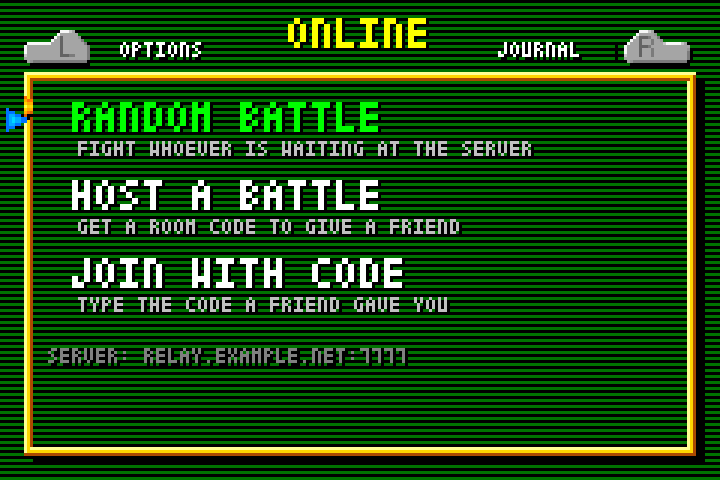
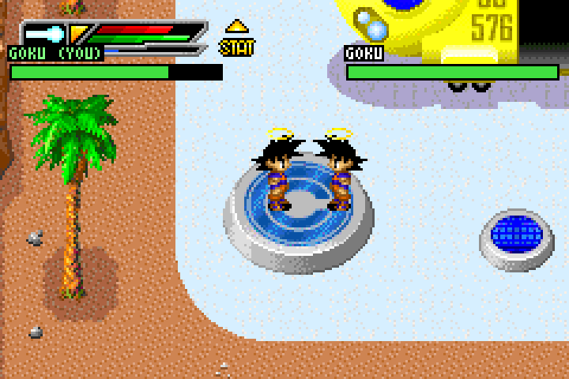
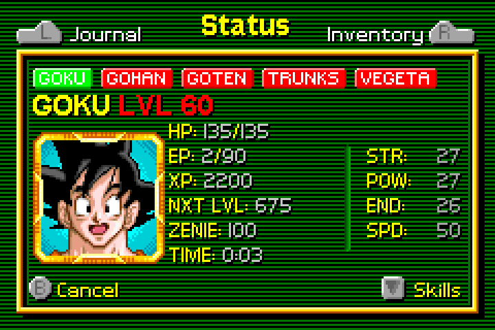

<h1 align="center">Buu's Fury Recomp</h1>

<p align="center"><i>Dragon Ball Z: Buu's Fury</i> (Game Boy Advance, 2004), statically recompiled into a native Linux program, with mods: one-on-one battles over the internet, all five story characters on the Switch Characters screen with outfits of their own, saves in a third of the time, save states, and HD picture modes.</p>

<p align="center">
  
  
  
</p>

> **You need your own copy of the game.** Nothing from the cartridge is in this repository or in the program it builds. Your ROM is needed to build, and again every time the game starts: the program checks the dump's SHA-1 against the one the code was recompiled from and runs no other.

## What the mods add

- **Online battles.** Press Start and go right past Options to the ONLINE page. RANDOM BATTLE pairs you with whoever else is waiting; HOST A BATTLE shows a four-digit code to give a friend; JOIN WITH CODE takes one. The fight starts where the host stands, with both characters; when one is beaten, both games are back exactly where they were. The two games run in lockstep through a small relay (`tools/netplay/`) that fits on a free cloud VM or on your own PC behind a free tunnel. Both players need the same build.
- **Every character.** Goku, Gohan, Goten, Trunks and Vegeta are all on the Switch Characters screen at any save pad, story or no story, each with his own level, health and attacks. Up and Down over a figure change his outfit, remembered in the settings. With Legacy of Goku II's ROM at hand, young Gohan's four outfits, Future Trunks and Vegeta's Saiyan armour join in (see below).
- **Faster saves.** Saving at a pad takes 0.4 seconds instead of 2.3; the save written is byte for byte the same.
- **Save states** on F5/F8, quit-and-resume, rolling crash snapshots, and a diary of what the game is doing (`~/.local/share/buusfury/buusfury.modlog`).
- **Picture modes** from the runtime: original pixels, xBRZ smoothing, or an HD redraw by a neural network on the GPU (F2); scanlines or an LCD grid (F3); colour correction (F4). Game controllers work.

## Quick start

A Debian/Ubuntu-like Linux on x86-64 with gcc, g++, make, cmake, git, python3 and the SDL2 runtime installed; a Vulkan-capable GPU for the HD picture mode.

```sh
./setup.sh                        # fetches and builds mGBA, xBRZ, ncnn and the rest under deps/, no root needed
nano games/buusfury/game.mk       # ROM: the path to your dump (SHA-1 e65738e9d67688309f09811a54f495523ec9aada)
make GAME=buusfury                # recompiles the game and builds ./buusfury
./buusfury --scale 4
```

`make` leaves a link to your ROM at `~/.local/share/buusfury/buusfury.gba`, the first place the program looks; `buusfury.gba` next to the program or `--rom FILE` work too. Keys: arrows move, X = A, Z = B, A = L, S = R, Enter = Start, Backspace = Select, Tab fast-forwards, Space skips scenes, F11 fullscreen, Esc quits. Quitting saves your place and starting resumes it. `./buusfury --help` lists everything.

**Playing online.** Put the relay's address in `~/.local/share/buusfury/buusfury.netplay` as `server host:port`; [tools/netplay/README.md](tools/netplay/README.md) says how to run the relay for nothing, on a free Google Cloud or Oracle VM (`tools/netplay/gcloud-up.sh`, `deploy.sh`) or on your own PC through a free tunnel (`host-here.sh`).

**The Legacy of Goku II outfits** are converted from that game's ROM by the scripts in `tools/sprites/` into `games/buusfury/mods/generated/`, which is not in the repository. Without them the game builds and plays the same, minus those outfits. [docs/PROJECT.md](docs/PROJECT.md) describes the conversion.

## Under the hood

`tools/recomp.py` turns the game's ARM and Thumb code into C, one function per block, each instruction being mGBA's own interpreter body inlined with a constant opcode, so gcc compiles it into specialised native code. mGBA's core supplies the hardware (video, sound, timers, DMA, saves) with its CPU loop patched to call the compiled blocks. Mods are C files in `games/buusfury/mods/` that hook game functions by address through the small API in `runtime/mod.h`. The full story, the mod API and everything found in the game so far are in [docs/PROJECT.md](docs/PROJECT.md).

The sibling for *The Legacy of Goku II*, which brings this game's characters, areas and bosses into it: [lgoku2-recomp](https://github.com/Aeanobis/lgoku2-recomp).

## Legal

An unofficial fan project, not affiliated with or endorsed by the game's publishers or rights holders. Dragon Ball and Buu's Fury belong to their owners. This repository contains no game data; use the program with a cartridge you own. Built on [mGBA](https://mgba.io) (MPL-2.0), [xBRZ](https://sourceforge.net/projects/xbrz/) (GPLv3), [ncnn](https://github.com/Tencent/ncnn) (BSD) and the Real-ESRGAN models, all fetched by `setup.sh` rather than included.
